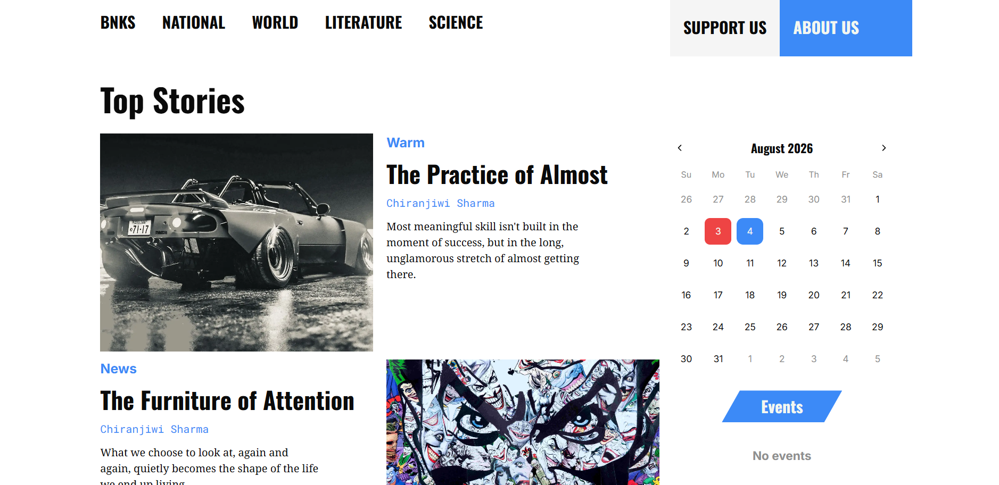

<h1 className="text-3xl md:text-4xl font-bold font-sans" align="center">परेवा_</h1>
<div align="center">

[](https://sebsna.org/donate/ "Donate")
[](https://www.youtube.com/@parewa_bnks)

[](https://github.com/budhanilkanthaschool/parewa/commits "Commit History")
[](https://github.com/budhanilkanthaschool/parewa/pulse/monthly "Last activity")
</div>
<div align="center">
  

</div>

## Table of Contents

- [Introduction](#introduction)
- [Overview](#overview)
- [Project Values](#project-values)
- [Tech Stack](#tech-stack)
- [Monorepo Structure](#monorepo-structure)
- [Getting Started](#getting-started)
- [Deployment](#deployment)
- [Content Management](#content-management)
- [Contributing](#contributing)
- [Maintainers](#maintainers)
- [License](#license)

## Introduction

Parewa is a student-led publishing platform built for showcasing news, articles, and student writing at Budhanilkantha School. Our mission is to connect students, alumni, and associates of Budhanilkantha School with original and impactful journalism.

[](https://www.youtube.com/watch?v=1G9VCFo4SHo)
<p align="center"><i>Click the image for video of the site</i></p>


## Overview

The original idea behind Parewa was to create a digital system for sending and receiving student notices across the school, replacing the paper-based notice system with the initiative launched by the 6000E batch in 2024.

Now, the project has evolved into a platform for bringing together current students, alumni, and associates of BNKS. We showcase top tier work from some of the brightest minds of our school for the world to see.

## Project Values

- Student-led development with practical ownership of the platform
- Clear, reliable communication for the school community.
- Expression of unique and original ideas from our community.
- Becoming the front face news platform of our school.

## Tech Stack

| Layer | Technology | Version / Notes |
| --- | --- | --- |
| Frontend | Next.js | 16.2.10 |
| Language | TypeScript | `^5` in `apps/web`, `^5.8` in `apps/studio` |
| UI | React | 19.2.7 |
| CMS | Sanity Studio | `^6.5.0` |
| Content API | next-sanity | `^13.1.1` |
| Styling | Tailwind CSS | `^4` |
| Component primitives | shadcn/ui | configured via `apps/web/components.json` |
| Icons | lucide-react, Iconify | `^1.24.0`, `^6.0.2` |
| Validation | Zod | `^4.4.3` |
| Package management | pnpm workspaces | root `devEngines.packageManager.version: ^11.12.0` |

## Monorepo Structure

```text
parewa/
├── apps/
│   ├── web/                # Public-facing Next.js application
│   └── studio/             # Sanity Studio for editors and moderators
├── packages/
│   └── sanity-config/      # Shared Sanity schema package (@parewa/sanity-config)
├── package.json            # Root workspace scripts
└── pnpm-workspace.yaml     # Workspace package definitions
```

- `apps/web`: Renders the homepage, article index, article detail pages, about page, newsletter actions, and event query endpoints.
- `apps/studio`: Hosts the editorial CMS where content, categories, links, events, users, and settings are managed.
- `packages/sanity-config`: Defines the shared Sanity schemas for content, users, organization metadata, and settings.

## Getting Started

### Prerequisites

- Node.js 20+
- pnpm 11+
- Access to the BNKS Sanity project

### 1. Clone and install

```bash
git clone https://github.com/budhanilkanthaschool/parewa.git
cd parewa
pnpm install
```

### 2. Configure environment variables

Create local environment files for the apps you are running and provide the same Sanity project details to both applications.

Required variable names used in the codebase:

```bash
SANITY_STUDIO_PROJECT_ID=
SANITY_STUDIO_DATASET=
SANITY_STUDIO_API_VERSION=
SANITY_STUDIO_TOKEN=
```

Notes:

- `apps/studio` reads `SANITY_STUDIO_PROJECT_ID`, `SANITY_STUDIO_DATASET`, and `SANITY_STUDIO_API_VERSION`.
- `apps/web` reads the same three values and also uses `SANITY_STUDIO_TOKEN` for server-side Sanity access, including newsletter subscription mutations and event queries.
- The web app and Studio must point to the same Sanity project and dataset or your local content will not match.

### 3. Run the applications

Run both apps together from the repository root:

```bash
pnpm dev
```

Or run them individually:

```bash
pnpm dev:web
pnpm dev:studio
```

Useful app-level commands:

```bash
pnpm --filter @parewa/web build
pnpm --filter @parewa/web lint
pnpm --filter @parewa/studio build
pnpm --filter @parewa/studio deploy
```

Since parewa uses sanity for schemas and types, we can use sanity's typegens in the nextjs application through the following commands
```bash
cd apps/studio
pnpm dlx sanity schema extract
pnpm dlx sanity typegen generate
```

Default local URLs are typically:

- Web: `http://localhost:3000`
- Studio: `http://localhost:3333`

## Deployment

Parewa is a live production platform, but the repository currently does not include checked-in CI workflows or host-specific deployment configuration under `.github/` or `.vercel/`. That means the exact production host, auto-deploy trigger, and merge-to-live process are not documented in code in this repository today.

What is documented in the repo:

- The web app builds with `next build`
- The Studio builds with `sanity build`
- The Studio can be deployed with `pnpm --filter @parewa/studio deploy`

Recommended maintainer action:

- Add a short internal operations note once the team confirms the production host, who has access, and whether merges to `main` deploy automatically.

## Content Management

For editors and moderators using Sanity Studio:

1. Open the Studio locally or at the production Studio URL and sign in with your authorized Sanity account.
2. Go to `Content` and open `Articles` to create or edit a post.
3. Fill in the required fields: title, slug, one-liner, content, category, image description, and published date.
4. If the post is a school notice, publish it under the appropriate category used for notices in your content model.
5. Click `Publish` when the post is ready to appear on the public site.
6. To remove a published post, open the document actions menu in Studio and use `Unpublish`.

Other important Studio areas:

- `Events` for calendar-style items with date and location
- `Categories`, `Links`, `Social Links`, and `General` for navigation and site settings
- `Students`, `Teachers`, `Alumni`, and `Guests` for author attribution

> [!IMPORTANT]
> Whether you have feedback on features, have encountered any bugs, or have suggestions for enhancements, we're eager to hear from you. Your insights help us make the PAREWA more robust and user-friendly.

## Contributing

For new student maintainers:

1. Create a branch from `main` using a clear name such as `feat/article-search`, `fix/newsletter-api`, or `docs/readme-refresh`.
2. Make focused changes and verify them locally before opening a pull request.
3. Open a pull request with a short summary, screenshots for UI changes, and any setup notes reviewers need.
4. Use GitHub Issues for bugs and feature requests, and use the repository Projects or issue labels for roadmap tracking if your team enables them.

There are currently no checked-in CI workflow files in this repository, so review and local verification remain especially important.

**If you encounter and come across any sorts of issues be sure to contact us at:**
```bash
parewa@bnks.edu.np
```

## Maintainers

- [Aarohan, Sulav and Himshikhar - Technical Leads]
- [Bibhu and Ashlesha - Design / Marketing Leads]
- [Sabikshya and Shishtata - Editors]
- [PDC - Faculty Advisor]

## License

Released under GPL-3.0-only; see the [LICENSE](LICENSE) file or [GNU overview](https://www.gnu.org/licenses/gpl-3.0.en.html) for permissions and redistribution requirements.
